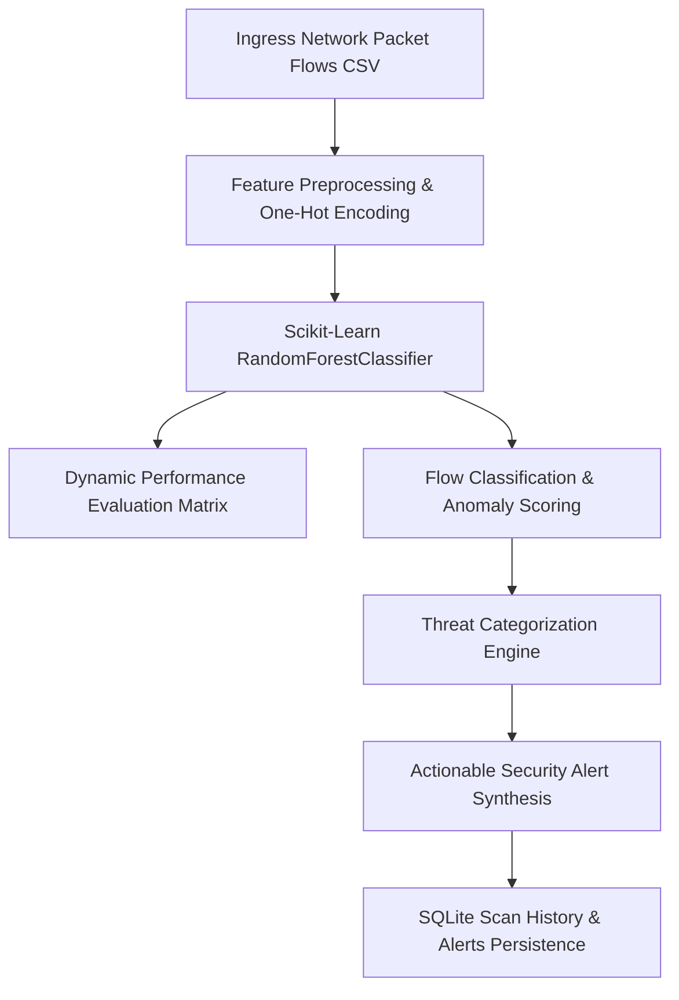

# AI-Based Network Intrusion Detection System
## Software Engineering Capstone — Confluence Documentation Pack: Volume 2
### System Architecture & Machine Learning Formulation

---

### 1. Architectural Overview

---

### 2. NetFlow Feature Engineering
The engine extracts and normalizes 12 core network flow features aligned with the benchmark NSL-KDD dataset:
1. `duration`: Length of connection in seconds.
2. `protocol_type`: Transport protocol (`tcp`, `udp`, `icmp`).
3. `service`: Application layer service (`http`, `dns`, `smtp`, `ftp`, `ssh`, etc.).
4. `flag`: TCP connection status flag (`SF`, `S0`, `REJ`, `RSTO`, etc.).
5. `src_bytes`: Bytes sent from source to destination.
6. `dst_bytes`: Bytes sent from destination to source.
7. `count`: Number of connections to the same host in past 2 seconds.
8. `srv_count`: Connections to the same service in past 2 seconds.
9. `serror_rate`: Percentage of connections with SYN errors.
10. `same_srv_rate`: Percentage of connections to the same service.
11. `dst_host_count`: Destination host connection accumulation.
12. `dst_host_srv_count`: Destination host service connection accumulation.

---

### 3. Mathematical Model: Random Forest Ensemble

Given an input feature vector $\mathbf{x} \in \mathbb{R}^d$, the ensemble prediction $\hat{y}$ from $B = 100$ decision trees is given by majority vote:

$$\hat{y} = \arg\max_{c \in \{0, 1\}} \frac{1}{B} \sum_{b=1}^{B} I(T_b(\mathbf{x}) = c)$$

Each tree $T_b$ is trained on a bootstrap sample using the **Gini Impurity** criterion:

$$I_G(p) = 1 - \sum_{i=1}^{C} p_i^2$$

#### Dynamic Evaluation Metrics
- **Accuracy:** $\frac{TP + TN}{TP + TN + FP + FN}$
- **Precision:** $\frac{TP}{TP + FP}$
- **Recall (Detection Rate):** $\frac{TP}{TP + FN}$
- **F1-Score:** $2 \cdot \frac{\text{Precision} \cdot \text{Recall}}{\text{Precision} + \text{Recall}}$

All evaluation scores are dynamically calculated on an independent held-out 25% test split (500 records) — zero hardcoded metrics.
